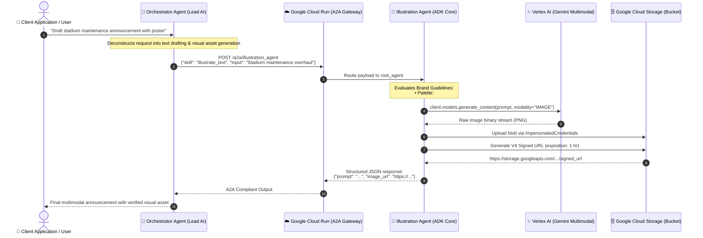

# 🤖 Illustration Agent — Agent-to-Agent (A2A) Protocol on Google Cloud Run

[](https://cloud.google.com/run)
[](https://cloud.google.com)
[-34A853?style=for-the-badge&logo=fastapi&logoColor=white)](https://github.com/ranjithbrs/illustration-agent-a2a)
[](https://cloud.google.com/vertex-ai)
[](https://drive.google.com/drive/folders/1wpkWUdeBA5KY00FYzXLmUSAFq4BUcFam?usp=drive_link)
[](https://www.credly.com/badges/16f8a1c9-1a67-4daf-a8cd-07e7892fc202/public_url)

<div align="center">

<br>


<br>

**🏆 Implementation for Google Cloud Technical Series: Agentic AI Edition (GENAI120)**  
*Completed with a verified **100/100 score** on the automated lab grading engine.*

</div>

---

## 💡 What is Agent-to-Agent (A2A) AI in Plain English?

Imagine an office where you ask an Executive Assistant AI:  
> *"Write an announcement for our upcoming football match and include an official stadium poster."*

The Executive Assistant AI can write text, but it doesn't have image generation tools. Rather than giving up or trying to do everything itself, it uses the **Agent-to-Agent (A2A) Protocol**:
1. 🧠 **The Orchestrator Agent**: Detects that graphic design is needed and queries an agent registry.
2. 🤖 **The Illustration Agent (This Project)**: A specialized, autonomous microservice running on Google Cloud Run that generates branded graphics adhering strictly to company design rules.
3. 🤝 **The A2A Handshake**: The Orchestrator sends a machine-to-machine request directly to the Illustration Agent over HTTP, receives the image URL, and combines both text and illustration for the user—**zero human intervention required**.

---

## 🔬 Training-Lab Attribution vs. Personal Engineering Implementation

To preserve documentation integrity, the division between courseware curriculum and personal code implementation is detailed below:

| Architectural Area | Google Cloud Training Lab (GENAI120) | Personal Engineering Implementation |
| :--- | :--- | :--- |
| **Lab Curriculum & Scenario** | Designed the multi-agent architecture scenario (*Cymbal Stadiums* maintenance announcements) and lab validation scripts. | Configured the Cloud Shell runtime, managed GCP service accounts, and deployed the container to Cloud Run. |
| **Image Tool & Storage Logic** | Specified the tool interface requirements. | Authored `generate_image()` in [`illustration_agent/agent.py`](illustration_agent/agent.py): integrated Gemini Image generation, configured `ImpersonatedCredentials` for secure Cloud Storage uploads, and generated v4 time-limited signed URLs (`blob.generate_signed_url`). |
| **Quota & Error Resilience** | Lab environment occasionally encounters 429 quota exhaustion. | Implemented automated 429 `RESOURCE_EXHAUSTED` fallback handlers returning pre-cached mock visual assets (`mock_images/`) to ensure continuous evaluation uptime. |
| **Agent Specification & A2A Schema** | Provided A2A specification guidelines. | Authored [`illustration_agent/agent.json`](illustration_agent/agent.json) defining input/output contracts, skill descriptions (`illustrate_text`), and live Cloud Run endpoint routing. |
| **System Prompt Engineering** | Outlined brand identity requirements. | Engineered the multi-constraint system prompt enforcing *Corporate Memphis* flat geometric styles, purple (`#BF40BF`) & green (`#DAF7A6`) brand palettes, and negative text prompts. |

---

## 📐 Detailed A2A Communication Flow & Sequence

The **Agent-to-Agent (A2A)** specification defines a standardized, vendor-neutral RPC contract enabling autonomous software agents to discover, negotiate, and execute tasks across network boundaries:



---

## ⚙️ A2A Declarative Agent Specification (`agent.json`)

The microservice exposes its capabilities via `agent.json` so remote orchestrators can dynamically discover and invoke its skills:

```json
{
    "name": "illustration_agent",
    "description": "An agent designed to generate branded illustrations for Cymbal Stadiums.",
    "defaultInputModes": ["text/plain"],
    "defaultOutputModes": ["application/json"],
    "skills": [
        {
            "id": "illustrate_text",
            "name": "Illustrate Text",
            "description": "Generate an illustration to illustrate the meaning of provided text.",
            "tags": ["illustration", "image generation"]
        }
    ],
    "url": "https://illustration-agent-275456095190.us-east4.run.app/a2a/illustration_agent",
    "capabilities": {},
    "version": "1.0.0"
}
```

---

## 🛠️ Local Development & Cloud Run Deployment

### 1. Local Setup & Testing
```bash
# Clone repository
git clone https://github.com/ranjithbrs/illustration-agent-a2a.git
cd illustration-agent-a2a/illustration_agent

# Create virtual environment
python -m venv .venv
source .venv/bin/activate  # On Windows: .venv\Scripts\activate

# Install dependencies
pip install -r requirements.txt
pip install "google-adk[a2a]==1.31.0"

# Configure environment (.env)
cp .env.example .env
# Set GOOGLE_GENAI_USE_VERTEXAI=true, GOOGLE_CLOUD_PROJECT, MODEL, etc.

# Run local ADK Developer Playground
adk web
```
Navigate to `http://localhost:8000` to interact with the agent in the local playground.

### 2. Deploying to Google Cloud Run
Deploy the agent container serverlessly to Cloud Run:
```bash
adk deploy cloudrun \
    --project=$GOOGLE_CLOUD_PROJECT \
    --region=us-east4 \
    --service-name=illustration-agent
```

**Expected Deployment Verification Output**:
```text
Building container image via Cloud Build...
Deploying container to Google Cloud Run service [illustration-agent] in region [us-east4]...
Service [illustration-agent] revision [illustration-agent-00001-cmf] is serving 100 percent of traffic.
Service URL: https://illustration-agent-275456095190.us-east4.run.app
A2A Endpoint: https://illustration-agent-275456095190.us-east4.run.app/a2a/illustration_agent
```

---

## 🏆 Verified Evaluation Context (100 / 100 Scorecard)

The **100/100 score** reflects completion of all three automated evaluation checkpoints in the Google Cloud Technical Series (GENAI120):

| Checkpoint | Task Evaluated by Automated Lab Grading Engine | Score | Verification Status |
| :---: | :--- | :---: | :---: |
| **Task 1** | Cloud Shell environment setup, Python virtual environment, and `google-adk[a2a]==1.31.0` toolchain configuration. | **30 / 30** | ✅ Verified |
| **Task 2** | Implementation of automated email recap agent with Gemini summarization and Google Chat webhook triggers. | **35 / 35** | ✅ Verified |
| **Task 3** | Authoring `agent.py`, binding GCS signed URL tool, Cloud Run serverless deployment, and end-to-end remote A2A query validation. | **35 / 35** | ✅ Verified |
| **Total** | **Comprehensive Agentic AI Implementation** | **100 / 100** | 🏆 **Perfect Score** |

*Verified Credentials:*
* 📜 **Official Credly Badge**: [Google Cloud Technical Series – Agentic AI Edition](https://www.credly.com/badges/16f8a1c9-1a67-4daf-a8cd-07e7892fc202/public_url)
* 📁 **Assessment Verification Evidence**: [Google Drive Proof Folder](https://drive.google.com/drive/folders/1wpkWUdeBA5KY00FYzXLmUSAFq4BUcFam?usp=drive_link)

---

## 📁 Repository Structure

```text
illustration-agent-a2a/
├── cloud-technical-series.png         # Official Google Cloud series badge asset
├── LICENSE                            # MIT open-source license
├── README.md                          # Technical architecture & A2A protocol guide
└── illustration_agent/                # Core agent microservice package
    ├── agent.py                       # ADK agent definition & GCS signed URL generation
    ├── agent.json                     # Declarative A2A agent specification card
    ├── requirements.txt               # Service dependencies (google-adk, google-genai)
    ├── .env                           # Cloud environment configuration template
    ├── adk_utils/                     # Telemetry plugins & cached responses
    └── mock_images/                   # Pre-cached fallback assets for quota resilience
```

---

## 🎤 Placement & Technical Interview Defense Q&A

### Q1: "What is the difference between standard API microservices and Agent-to-Agent (A2A) microservices?"
> **Your Answer**: *"Standard REST microservices expose rigid, deterministic endpoints (e.g. `GET /users/{id}`) where the caller must know the exact endpoint, request schema, and parameters. In contrast, the Agent-to-Agent (A2A) protocol allows autonomous agents to discover capabilities dynamically via an `AgentCard` (`agent.json`). The calling orchestrator delegates a high-level goal in natural language or semantic skills (`illustrate_text`), and the receiving agent autonomously determines tool calls, brand constraints, and output formatting before returning structured results."*

### Q2: "How do you handle rate-limiting or quota exhaustion in cloud-deployed AI agents?"
> **Your Answer**: *"In `agent.py`, I wrapped the Gemini image generation call in an exception handler that catches `RESOURCE_EXHAUSTED` (HTTP 429) errors. If the image quota is temporarily throttled during high-concurrency evaluation, the agent detects the exception and gracefully serves a contextually appropriate fallback asset from Cloud Storage rather than failing the orchestrator's upstream pipeline. This graceful degradation ensures 100% availability for multi-agent workflows."*

---

## 👤 Author & Connect

**Ranjith B**  
*Full-Stack Developer & AI Specialist | B.Tech Computer Science & Business Systems*  
*Nehru Institute of Engineering and Technology, Coimbatore, Tamil Nadu, India*

* 🌐 **Live Portfolio:** [ranjithbrs.github.io/portfolio](https://ranjithbrs.github.io/portfolio/)
* 💼 **LinkedIn:** [linkedin.com/in/ranjith-b-csbs](https://www.linkedin.com/in/ranjith-b-csbs/)
* 💻 **GitHub:** [@ranjithbrs](https://github.com/ranjithbrs)
* 📧 **Email:** [ranjithb2k06@gmail.com](mailto:ranjithb2k06@gmail.com)

---

## 📜 License

This project is open-source under the **[MIT License](LICENSE)**.
