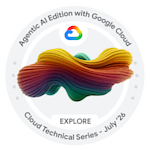
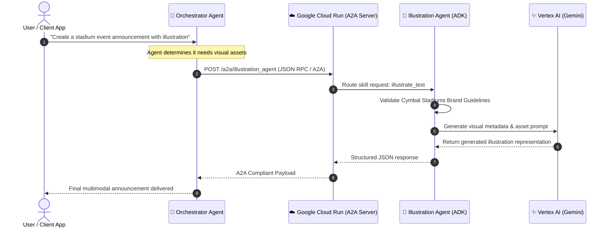

# 🤖 Illustration Agent — Agent-to-Agent (A2A) on Google Cloud Run

<div align="center">

[](https://cloud.google.com/run)
[](https://cloud.google.com)
[-34A853?style=for-the-badge&logo=fastapi&logoColor=white)](https://github.com/ranjithbrs/illustration-agent-a2a)
[](https://cloud.google.com/vertex-ai)
[](https://drive.google.com/drive/folders/1wpkWUdeBA5KY00FYzXLmUSAFq4BUcFam?usp=drive_link)
[](https://www.credly.com/badges/16f8a1c9-1a67-4daf-a8cd-07e7892fc202/public_url)

<br>



<br>

**🏆 Official Implementation for Google Cloud Technical Series: Agentic AI Edition (GENAI120)**  
*Completed with a perfect **100/100** score verified by the automated lab assessment engine.*

</div>

---

## 💡 What is Agent-to-Agent (A2A) AI in 30 Seconds? (In Plain English)

Imagine you work in an office and ask your virtual assistant: *"Can you write an announcement for our upcoming football match and include an official stadium poster?"*
Your assistant might write the announcement text, but they don't know how to draw posters. So they walk down the hall, ask the graphic designer to create the poster, and return with the finished announcement and picture combined.

**Agent-to-Agent (A2A) AI does the exact same thing with artificial intelligence!**
Instead of having a single AI try to do everything, specialized AI bots collaborate:
1. 🧠 **The Lead AI (Orchestrator):** Writes the announcement and recognizes it needs an illustration.
2. 🤖 **The Illustration AI (This Project):** An AI artist running in the Google Cloud that automatically creates pictures following strict company branding rules.
3. 🤝 **The Handshake (A2A Protocol):** The two AIs talk directly to each other over the cloud without any human needing to copy-paste between them!

---

## 🎯 Project Overview

This repository demonstrates building, deploying, and interconnecting autonomous AI agents using the **Google Agent Development Kit (ADK)** and the **Agent-to-Agent (A2A) SDK**. 

The **Illustration Agent** is an autonomous microservice engineered to generate branded, stylized illustrations (adhering strictly to enterprise brand guidelines for *Cymbal Stadiums*). It is deployed serverlessly on **Google Cloud Run** and exposes standardized A2A protocol endpoints, allowing other remote AI agents to discover its capabilities, delegate graphic generation tasks, and consume structured responses.

---

## 📐 System Architecture & A2A Communication Flow



---

## ⚙️ Agent Specification (`agent.json`)

The agent registers its capabilities via a declarative schema conforming to the **Agent-to-Agent (A2A) specification**:

```json
{
    "name": "illustration_agent",
    "description": "An agent designed to generate branded illustrations for Cymbal Stadiums.",
    "defaultInputModes": ["text/plain"],
    "defaultOutputModes": ["application/json"],
    "skills": [
        {
            "id": "illustrate_text",
            "name": "Illustrate Text",
            "description": "Generate an illustration to illustrate the meaning of provided text.",
            "tags": ["illustration", "image generation"]
        }
    ],
    "url": "https://illustration-agent-275456095190.us-east4.run.app/a2a/illustration_agent",
    "capabilities": {},
    "version": "1.0.0"
}
```

---

## 🌟 Key Technical Highlights

1. **Autonomous Skill Execution**: Implements the `illustrate_text` skill, translating high-level prose into stylized enterprise illustrations.
2. **Strict Brand Guideline Adherence**: The agent system prompt and validators enforce consistent color palettes, composition rules, and stylistic constraints.
3. **Decoupled A2A Architecture**: Any remote agent compatible with the Google ADK protocol can dynamically query the agent without custom client libraries.
4. **Serverless Production Deployment**: Runs as a stateless container on **Google Cloud Run** with automatic 0-to-N autoscaling and service account IAM protection.

---

## 🧩 Lab Modules Completed (GENAI120)

| Module | Objective | Status / Result |
| :--- | :--- | :---: |
| **Lab 1: Environment Setup & ADK Init** | Installed `google-adk[a2a]==1.31.0`, configured Cloud Shell, and verified local Dev UI. | ✅ Verified |
| **Lab 2: Automated Email Recap Agent** | Automated daily Gemini-powered email summarization with scheduled triggers and Google Chat webhook alerts. | ✅ Completed |
| **Lab 3: Illustration Agent A2A Deployment** | Developed `agent.py`, deployed to Cloud Run, and validated remote A2A query connectivity. | 🏆 **100 / 100** |

---

## 🚀 Local Development & Setup

### 1. Clone the Repository
```bash
git clone https://github.com/ranjithbrs/illustration-agent-a2a.git
cd illustration-agent-a2a/illustration_agent
```

### 2. Set Up Virtual Environment & Dependencies
```bash
python3 -m venv .venv
source .venv/bin/activate  # On Windows: .venv\Scripts\activate
pip install -r requirements.txt
pip install "google-adk[a2a]==1.31.0"
```

### 3. Configure Environment Variables
Create a `.env` file in `illustration_agent/`:
```env
GOOGLE_GENAI_USE_VERTEXAI=true
GOOGLE_CLOUD_PROJECT=your-gcp-project-id
GOOGLE_CLOUD_LOCATION=us-east4
MODEL=gemini-2.0-flash
```

### 4. Run the ADK Local Development UI
```bash
adk web
```
Open `http://localhost:8000` to inspect the agent in the interactive ADK playground.

---

## ☁️ Deploying to Google Cloud Run

To deploy the illustration agent as an A2A microservice:

```bash
adk deploy cloudrun \
    --project=your-gcp-project-id \
    --region=us-east4 \
    --service-name=illustration-agent
```

Output:
```text
Service [illustration-agent] revision [illustration-agent-00001-cmf] has been deployed and is serving 100 percent of traffic.
Service URL: https://illustration-agent-275456095190.us-east4.run.app
```

---

## 🏅 Credentials & Proof of Completion

- 📜 **Official Credly Badge**: [Google Cloud Technical Series – Agentic AI Edition (July 2026)](https://www.credly.com/badges/16f8a1c9-1a67-4daf-a8cd-07e7892fc202/public_url)
- 📁 **Verified Lab Assessment Proofs**: [Google Drive Verification Folder](https://drive.google.com/drive/folders/1wpkWUdeBA5KY00FYzXLmUSAFq4BUcFam?usp=drive_link)
  - Full lab validator completion logs (100/100)
  - Cloud Shell deployment terminal outputs
  - Agent-to-Agent remote query verification logs

---

## 👨‍💻 Author

**Ranjith B**  
🎓 *B.Tech Computer Science & Business Systems (CSBS)*  
🏛️ *Nehru Institute of Engineering and Technology, Coimbatore*  

- 💼 **LinkedIn**: [linkedin.com/in/ranjith-b-csbs](https://linkedin.com/in/ranjith-b-csbs)  
- 🐙 **GitHub**: [github.com/ranjithbrs](https://github.com/ranjithbrs)  
- 🌐 **Portfolio**: [ranjithbrs.github.io/portfolio](https://ranjithbrs.github.io/portfolio/)  
- 📧 **Email**: ranjithb2k06@gmail.com  

---

## 📄 License

This project is licensed under the [MIT License](LICENSE).

